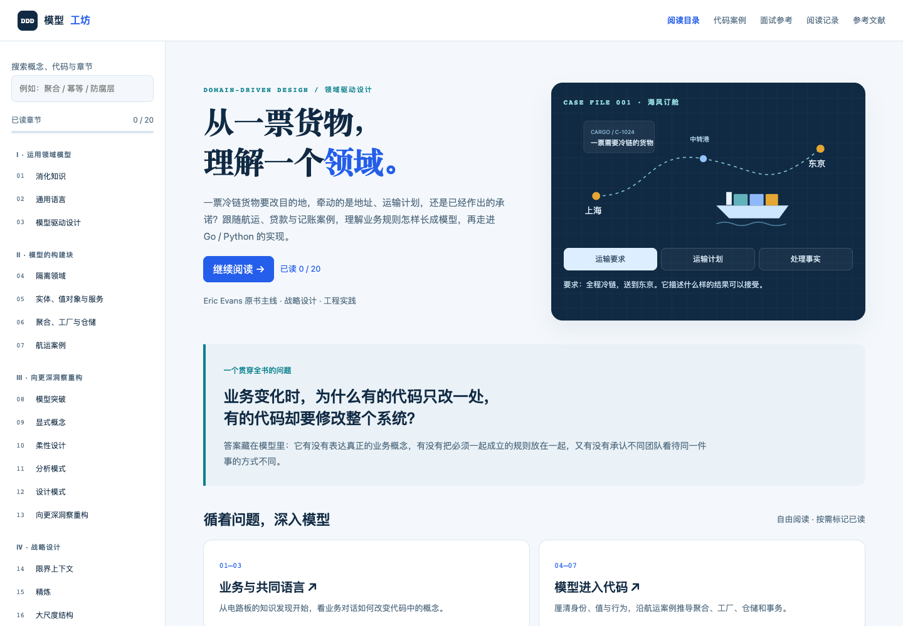

# DDD 模型工坊

[](https://github.com/yuanhuizang-cloud/ddd-model-workshop/actions/workflows/ci.yml)
[](LICENSE)
[](LICENSE-CONTENT)

从一票货物，理解一个领域。一个面向 Go / Python 后端工程师的中文 DDD 阅读网站：以 Eric Evans 原书为主线，把业务语言、模型演进、设计取舍和工程失败串成可理解的故事。

**[在线阅读](https://yuanhuizang-cloud.github.io/ddd-model-workshop/)** · [课程源码](content/lessons.json) · [Go / Python 示例](examples/) · [面试参考](content/interview-notes.md)



## 可以读到什么

- 20 个阅读单元、约 5.5 万汉字正文：17 章原书主线，加规格、一致性工程和订舱系统三个专题。
- 从电路板知识发现、采购订单并发、航运模型、银团贷款份额与记账案例，理解模型如何演变。
- 聚合、工厂、仓储、规格与柔性设计；限界上下文、核心领域、大尺度结构和遗留系统迁移。
- Go 内存并发示例，Python SQLite 原子提交，以及确认、取消、过期、Outbox、Inbox 和状态投影。
- 真实面经来源与 8 道高级工程师参考答案，明确区分原始主题和原创追问。
- 中文图解、来源标注、全文搜索、代码语言切换、连续阅读与打印。

自由阅读，无测验或评分流程。已读标记为可选功能，只保存在当前浏览器；可以导出、导入备份。网站没有账号系统、分析埋点或后台服务。

## 本地阅读

下载仓库后，直接用浏览器打开 [`docs/index.html`](docs/index.html)。HTML 内嵌正文、图片和代码，离线可读；外部参考链接需要联网。`docs/ddd-code-examples.zip` 为配套代码下载包。

也可以运行静态服务器：

```sh
python3 -m http.server 8000 --directory docs
```

浏览器访问 `http://localhost:8000`。不同浏览器或站点地址的已读记录分别保存，需要时通过备份迁移。

## 课程路线

| 单元 | 主题 |
| --- | --- |
| 01–03 | 知识消化、通用语言、模型与实现 |
| 04–07 | 分层、实体与值对象、聚合、工厂、仓储、航运案例 |
| 08–13 | 模型突破、显式概念、规格、柔性设计、分析模式、重构 |
| 14–17 | 限界上下文、核心精炼、大尺度结构、团队与战略 |
| 18–20 | 规格逻辑、一致性工程、订舱生命周期与消息恢复 |

## 构建与检查

构建只需要 **Python 3.9+ 标准库**，不需要 Node 包或前端构建框架。

```sh
python3 scripts/build.py
python3 scripts/build.py --check
python3 -m unittest discover -s tests -v
python3 -m unittest discover -s examples/python -v
node --check web/app.js
```

Go 示例需要 **Go 1.22+**；`-race` 需要支持 race detector 的平台及相应 C 工具链。

```sh
cd examples/go
go test -race ./...
```

`docs/` 是已提交的可复现产物。修改内容、页面或代码后重新运行构建，并一起提交源码和产物。CI 检查产物是否同步，并运行网站结构检查与 Go / Python 测试。

## 仓库结构

```text
content/        章节、参考文献、面试答案和图示清单
web/            页面模板、样式、交互脚本与图片
examples/       Go / Python 实现和行为测试
scripts/        无第三方依赖的构建脚本
tests/          课程结构、离线打包与来源边界检查
docs/           可直接打开的 HTML、代码 ZIP、GitHub Pages 发布目录
.github/        CI、Issue 模板和 PR 模板
```

## 工程边界

示例强调业务规则与失败协议：Go 版本为内存适配器，进程退出后不持久；Python 使用 SQLite，消息交付以回调连接两个数据库，未接入真实 MQ 或外部支付。代码不包含生产鉴权、租户隔离、退款及完整运维体系。数据库锁粒度、消息确认和外部副作用需要在具体基础设施上继续验证。详见 [示例说明](examples/README.md)。

## 来源与许可

本项目不是 Eric Evans、Martin Fowler 或所引第三方的官方课程。原书章节及案例有出处；短引文、原书转述、海风教学案例和现代工程补充分别说明。PDF 页码对应课程参考的 567 页英文重排版本，纸书页码可能不同。

- 源码及原创可执行示例：[MIT](LICENSE)。
- 原创教程、项目文档与 SVG 图解：[CC BY 4.0](LICENSE-CONTENT)。
- 官方 DDD Reference 图与短引文：[第三方材料与许可说明](THIRD_PARTY_NOTICES.md)。

欢迎通过 [Issue](https://github.com/yuanhuizang-cloud/ddd-model-workshop/issues) 提交概念纠错、案例建议或代码问题。贡献方式见 [CONTRIBUTING.md](CONTRIBUTING.md)。
